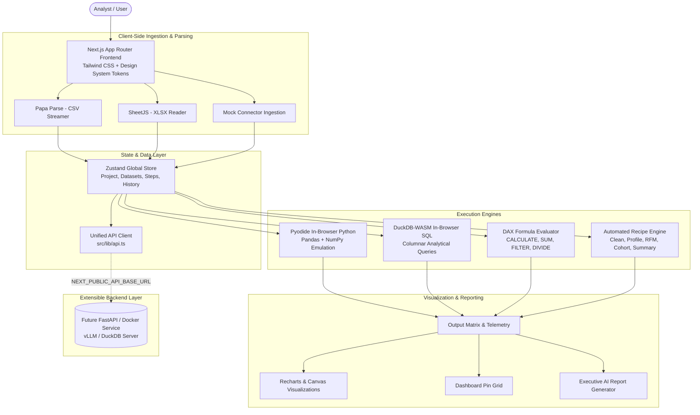

# System Architecture - DataQuery Web

DataQuery Web (`dataquery.in`) is an all-in-one, client-first data build tool designed for rapid ingestion, visual playground transformation, multi-engine execution (Python, SQL, DAX-style formulas), dashboard composition, and automated AI reporting.

---

## 🏛️ High-Level System Architecture

---

## 🔑 Key Architecture Principles

1. **Free-Tier Serverless Fit**:
   - The frontend is 100% functional without heavy server costs.
   - Parsing, analytical queries, and visualizations execute in the browser using WebAssembly and lightweight engines.
   - Long-running pipelines, distributed databases, Airflow, and local LLMs are routed through the `/lib/api.ts` contract, enabling clean decoupling.

2. **Single API Contract Layer (`src/lib/api.ts`)**:
   - Components never make raw `fetch` calls directly to arbitrary URLs.
   - If `NEXT_PUBLIC_ENABLE_MOCKS=true`, the API returns rich, realistic mock data with simulated network latency.
   - When connected to a real production backend, switching `NEXT_PUBLIC_ENABLE_MOCKS=false` and providing `NEXT_PUBLIC_API_BASE_URL` works instantly without changing UI components.

3. **Plan Gating & Security Boundaries**:
   - Feature flags and usage quotas (`src/lib/plans.ts`) enforce row limits, file size caps, run quotas, and Pro features.
   - Data privacy: User data files are processed in-memory client-side and never leaked into console logs or untrusted trackers.
